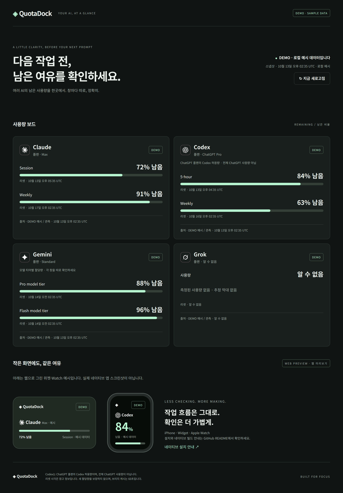
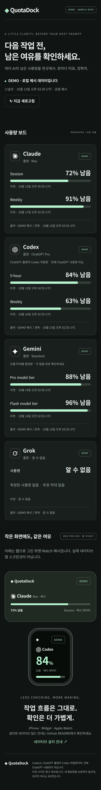

# QuotaDock

**Your AI allowance, at a glance — on iPhone, Apple Watch, and widgets.**


[](LICENSE)

QuotaDock turns the output of your **installed [CodexBar](https://github.com/steipete/CodexBar) CLI** into a small, authenticated snapshot. Provider credentials stay on the host. Clients receive remaining allowance, reset information, and freshness — not account identities.

> **v0.1.0 SOURCE PREVIEW.** Source builds only: no App Store, TestFlight, signed installer, or production-readiness claim. The GitHub destination is `deploy103/quotadock`. Provider availability depends on CodexBar and your account.



<details>
<summary>Mobile web demo (Chromium touch emulation, not native iOS)</summary>

</details>

## How it works

```text
┌────────────────┐    ┌──────────┐    ┌───────────────────┐
│ Local accounts │───▶│ CodexBar │───▶│ QuotaDock bridge  │
└────────────────┘    └──────────┘    │ No account IDs    │
                                     └─────────┬─────────┘
                       bearer auth + private HTTPS (local web: loopback HTTP)
                                               │
                  ┌─────────────┬───────────────┴────────────┐
                  ▼             ▼                            ▼
          ┌───────────────┐ ┌────────┐             ┌──────────────────┐
          │ Web dashboard │ │ iPhone │             │ iOS widgets      │
          └───────────────┘ └────┬───┘             │ Home/Today/Lock  │
                                 │                 └──────────────────┘
                          WatchConnectivity (snapshot only, no token)
                                 ▼
                       ┌──────────────────┐
                       │ Watch + widgets  │
                       └──────────────────┘
```

The zero-dependency bridge invokes fixed CodexBar commands, caches results for 60 seconds, and serves the [v1 snapshot contract](docs/contract.md). A GET is not necessarily a fresh provider request. Optional polling runs only while the bridge process is running.

## Support matrix

| Surface | Requirements | Preview status / limits |
| --- | --- | --- |
| Bridge | Node.js 22; installed CodexBar for live data | Local source CLI; demo needs no provider login |
| Web | Modern browser on bridge host | Loopback HTTP; not a public hosted service |
| iPhone | iOS 17+, Mac with Xcode 16+ to build | Source only; real device requires trusted HTTPS |
| iOS widgets | iOS 17+, installed native app | OS-scheduled updates; not live counters |
| Apple Watch / widgets | watchOS 10+, paired iPhone | Cached sanitized snapshots; not direct provider login |

| Provider | What the display means |
| --- | --- |
| Claude | Account-dependent measured CodexBar windows |
| Codex | **Codex allowance under a ChatGPT plan, not total ChatGPT usage** |
| Gemini | Account/model-tier dependent; do not assume session/weekly windows |
| Grok | Account/source dependent; unavailable or unknown may be expected |

Unknown values stay unknown (`null`), never synthetic zero. Only a measured zero means exhausted. Windows must not be summed. Reset times are information, not a promise of quota replenishment.

## 빠른 시작 · Korean quickstart

Node.js 22를 설치하고 저장소 루트에서 실행하세요. 브리지 자체에는 npm 의존성이 없습니다.

```sh
git clone https://github.com/deploy103/quotadock.git
cd quotadock
node bridge/cli.mjs init
node bridge/cli.mjs status --demo
node bridge/cli.mjs serve --demo
```

`init`는 로컬 페어링 토큰을 생성합니다. **토큰을 터미널 로그, 이슈, 스크린샷에 공유하지 마세요.** 웹 화면은 같은 컴퓨터의 `http://127.0.0.1:8787`에서 확인합니다. Demo 표시는 실제 계정 사용량이 아닙니다.

계정 없이 UI만 둘러보려면 `http://127.0.0.1:8787/?demo=1`을 여세요.
기본 화면의 연결 폼은 같은 주소에서만 작동합니다. 토큰 파일을 로컬에서
안전하게 열어 폼에 입력하세요. 다른 호스트의 토큰을 입력하지 마세요.

실제 사용량: CodexBar를 별도로 설치하고 앱에서 계정을 설정한 후 CLI를 설치하세요 (CodexBar → Preferences → Advanced → Install CLI). 다음 명령으로 확인합니다.

```sh
node bridge/cli.mjs status
node bridge/cli.mjs serve
```

iPhone에서 `127.0.0.1`은 Mac이 아닌 iPhone 자신입니다. 실제 기기는 **사설 VPN과 HTTPS 리버스 프록시** 또는 아래 네이티브 TLS 구성을 사용하고 신뢰할 수 있는 인증서를 설정하세요. 인증 없이 공개 인터넷에 노출하면 안 됩니다.

## Configuration

| Environment variable | Default / requirement |
| --- | --- |
| `QUOTADOCK_HOST` | `127.0.0.1` |
| `QUOTADOCK_PORT` | `8787` |
| `QUOTADOCK_TOKEN_FILE` | `~/.config/quotadock/token` |
| `QUOTADOCK_CODEXBAR_BIN` | `codexbar` |
| `QUOTADOCK_POLL_SECONDS` | Optional; at least `60` |
| `QUOTADOCK_TLS_CERT` | PEM certificate path; paired with TLS key |
| `QUOTADOCK_TLS_KEY` | PEM private-key path; paired with certificate |

Both TLS settings are required for non-loopback binding. Use private networking and restrict access with a firewall; TLS is not a substitute for bearer authentication. A reverse proxy must preserve authentication and must not log authorization headers. Do not publish the service on an unauthenticated tunnel.

## Build the Apple app, widgets, and Watch

1. Use a **Mac with Xcode 16+** and install XcodeGen. Linux cannot build Apple targets.
2. From `apple/`, run `xcodegen generate` using `project.yml`, then open the generated `.xcodeproj` in Xcode.
3. Select the iOS app scheme and an iOS 17+ simulator. Simulator builds can be unsigned; physical devices require your development team and signing setup.
4. For devices, configure the bundle prefix (`com.quotadock.app` by default), App Group (`group.com.quotadock.app`), and shared Keychain access group consistently across targets. Configure signing locally; never commit signing credentials.
5. In the app, pair with your private HTTPS bridge and its token. The token belongs in Keychain, including shared widget access; sanitized snapshots belong in the App Group cache.
6. Add **All AI allowances** for the four-provider overview, or individual provider widgets from the Home Screen / Today View gallery. Add rectangular/circular/inline widgets on the Lock Screen. Install the companion Watch app on a paired watch and add its widget/complication where supported.

Provider icons are MIT-licensed Lobe Icons assets with provenance and trademark
notices in [third-party notices](THIRD_PARTY_NOTICES.md). Native source is not
yet built or visually verified on Apple SDKs; see [native verification limits](apple/README.md).

Watch receives snapshots through WatchConnectivity, **never the bridge token**. Watch widgets read the Watch's local cache. Use Xcode's scheme list as the source of truth for actual generated target names.

## Refresh and security tradeoffs

- iPhone refreshes on foreground/manual request; WidgetKit scheduling is controlled by the OS. Background delivery and Watch connectivity are not guaranteed. No push-notification or real-time refresh promise.
- Data older than 15 minutes is stale. Check the observed time before relying on a bar.
- The bridge host and CodexBar have privileged access to provider sessions. Keep both trusted and patched. QuotaDock is not a credential vault or an official provider client.
- Bearer tokens grant snapshot access. HTTPS protects transport; VPN/firewalls reduce exposure. Neither prevents access by someone who has stolen the token.
- Live quota queries may contact providers through CodexBar. Demo is the offline-safe starting point.

## Development and community

```sh
npm test
python3 .agents/skills/checking-codexbar-usage/scripts/test_codexbar.py
```

See [contributing](CONTRIBUTING.md), [security reporting](SECURITY.md), [changelog](CHANGELOG.md), and [third-party notices](THIRD_PARTY_NOTICES.md). Use the issue forms for reproducible bugs or focused proposals; never paste raw provider diagnostics or credentials. Repository-local skills provide read-only CodexBar inspection and safe QuotaDock verification; they are not installed globally.

Licensed under [MIT](LICENSE). QuotaDock is independent of CodexBar and the AI providers; provider names belong to their respective owners.
